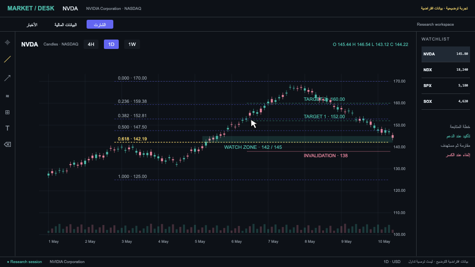
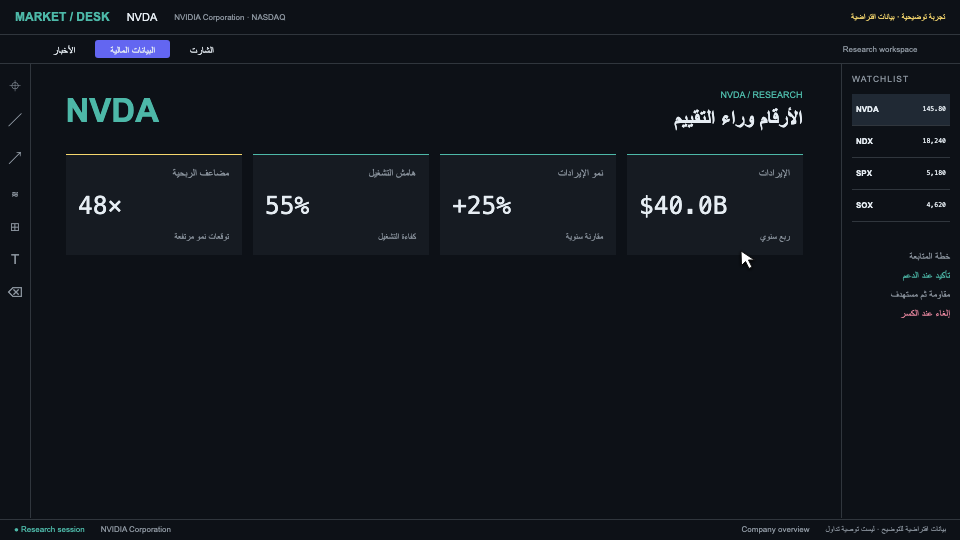

# Company analysis

> **Arabic video (RTL).** Start on the right and build toward the left. Draw, write, and reveal elements right to left, and lay out the screen in that same order. Follow the [global Arabic video direction rule](../../AGENTS.md#arabic-video-direction-rtl).

Horizontal research-terminal template, with one persistent application shell rather than slides.





```bash
python3 tools/create_project.py --format video --template company-analysis --narration ai --slug company-name --duration 120
```


## Authoring contract

Pass an `AnalysisData` object to `CompanyAnalysis`. Replace `demoAnalysis` with project-owned data. All example prices, OHLC, headlines, metrics and dates are synthetic. The demo displays and speaks this context. Set `demo: false` only for verified production data.

- `chapters`: absolute seconds for news, fundamentals, chart, daily and weekly views.
- `news`: title, explanation and editorial impact. Put source URLs and publication dates in project research notes for real reports.
- `metrics`: label, formatted value, period or explanation. Use the same reporting period and currency throughout.
- `frames`: chronological 4H, daily and weekly datasets. Supply actual OHLCV or an optional project-bound chart `screenshot`, plus min/max prices, support range, invalidation, targets and optional Fibonacci low/high anchors.
- `cues`: absolute narration-aligned seconds for moving averages, trend, watch zone, Fibonacci and targets.

Screenshots must be cropped to the plot itself, excluding platform UI, price axis and time axis. Current plot rectangle is x=60..1485, y=95..745 in the 1540×790 SVG. Price mapping uses y=125..745 and the frame min/max, so provide a matching crop or adjust that mapping before adding overlays. Keep a per-frame annotation manifest of pixel anchors and price calibration with supplied screenshots. Do not fabricate candles from a screenshot and describe them as actual price data. Screenshots replace synthetic candles and volume; the renderer retains its own axes and analysis overlay.

Moving averages are simple 20/50-period averages with partial windows at the left edge. For a production shot provide enough history or omit the warmup region. The optional `trend` tuple is [startCandleIndex, startPrice, endCandleIndex, endPrice]. Author it against the supplied chart for each project. Fibonacci is calculated from the supplied low/high anchors. Targets and invalidation are authored analytical inputs, never automatically inferred recommendations.

## Production sequence

1. Receive the approved analysis, news sources, fundamentals, screenshots/OHLCV, indicator settings and entry/exit conditions.
2. Write the Arabic narration and chapter windows in project.json.
3. Generate once with tools/prepare_narration.py, using --language ar --align-model small for Arabic.
4. Set reveal cues from the aligned word timestamps, not rough estimates.
5. Render every chapter and overlay reveal for visual QA, then render the 1920×1080 MP4.

No generated raster art is required: the native SVG chart remains sharp at delivery resolution. QA frames can serve as visual template references.
