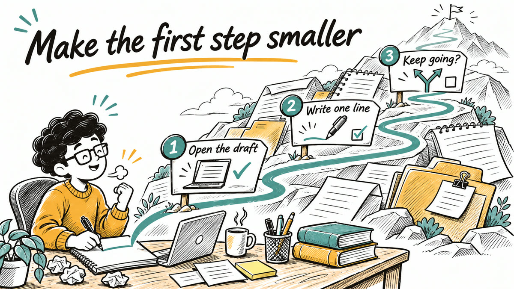
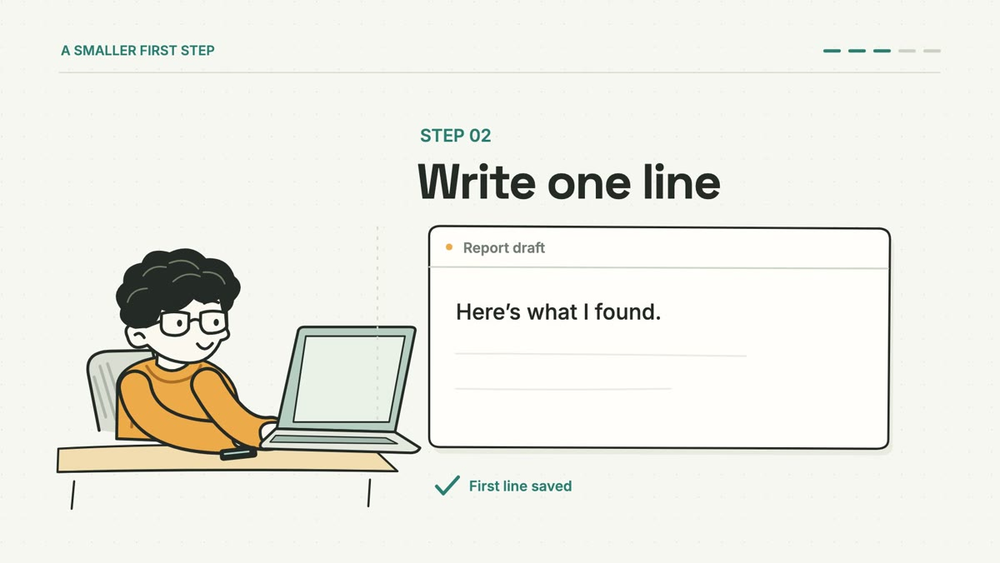

# Lines Anime

Template identifier: `lines-anime`. Listed in the [project template catalog](../../README.md#templates).
Use `$make-short` for vertical output or `$make-video` for horizontal output. Both use the
`motion` scaffold for this template; `--template lines-anime` is not a CLI option.

Use this template to turn a supplied illustration into an animated explainer. Keep the character
recognizable and give them actions that move the story forward. In *Make the First Step Smaller*,
Milo keeps the reference's curly hair, glasses, mustard sweater, and desk. The drawn mountain
becomes a single step, the draft fills as he types, and the route forks when he can choose to stop.

| Source illustration | Animated adaptation |
| --- | --- |
|  |  |

## Use it on a new project

> Use the Lines Anime template to turn this illustration into a one-minute animated story with AI narration.

1. Scaffold a `motion` project in the requested format. Use
   the shared Remotion helpers in `remotion/src/lib/lines-anime.tsx`
   as the scene starting point. Replace its composition ID, duration, dimensions, and scene cues
   with the new project's values. The demo is horizontal and silent so it runs with local assets.
2. Identify what makes the source character recognizable before drawing. Preserve the silhouette,
   face, clothing, and two or three key colors. Adapt
   [the SVG character and prop components](../../../remotion/src/lib/lines-anime.tsx)
   with separate moving parts for head, face, arms, hands, and props. Keep hands and props in contact
   when the character picks something up, opens it, or sets it down.
3. Give each scene one action and one visible result. In the starter, lifting the laptop opens a
   larger view of the draft. The character types, the words appear, and a checkmark confirms the
   result. Reuse a connector or path across scenes to make the cause and effect easy to follow.
   Keep open space around the character and the main diagram. For vertical video, stack them and
   reframe the action for captions.
4. For AI narration, prepare the full script with `tools/prepare_narration.py`. Replace the
   starter's authored frame cues with timings from `vo.gen.ts` or `vo[].words`. Start the gesture
   on the relevant verb and reveal its result as it becomes visible. Animate with frame-driven
   transforms and SVG paths.
5. Check frames before, during, and after each action. Look for slipping hands, unreadable text,
   hidden props, and diagram changes that lead the narration. A final pullback to the supplied
   illustration can reconnect the scenes to their source.

## Preview the starter

Open `LinesAnimeDemo` in Remotion Studio or render its key poses from the repository root.

```bash
cd remotion
npm run gen
node scripts/frames.mjs LinesAnimeDemo 0,53,139,218 --scale=0.5
```
