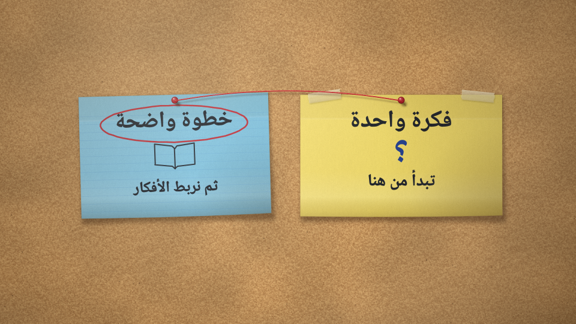

# Sticky-Note Wall

Use this template when the owner asks for Sticky Notes, Sticky-Note Wall, a cork-board
explainer, or the Arabic equivalents ستيكي نوتس / لوحة الورق اللاصق. Read this guide
and the supplied [original prompt and complete reference](REFERENCE.txt) before designing.
The original reference is archived verbatim. Its storyboard approval applies unless the
owner explicitly authorizes direct production, as in the Basair pilot.



## Reuse contract

Import `remotion/src/lib/sticky-notes.tsx` and author `scene.json`. The shared renderer,
paper, adhesive strips, lifted corners, shadows, cork, wood frame, pins, tape, yarn,
marker lines, doodles, text reveal, lighting, grain and sound kit already exist here.
Reuse these assets. Do not regenerate their images, rewrite their drawing recipes or
copy the Basair animation into a new project. See [assets.json](assets.json) for names
and provenance. Add new subject-specific drawings only when the story needs them.
Promote generally useful additions into this kit. Keep story content and timing local.

These are deterministic procedural assets, not AI-generated images. Rendering the
saved recipes is normal frame rendering and does not spend a provider request.
`helpers.js` wraps the original H library in a module scope; `sound.js` is the original
SOUND kit unchanged. `kit.js` preserves the supplied drawing recipes. `scene.js`
adds project-independent Arabic text, doodles, camera, cues and finishing passes from
the pilot. All projects share these files. Static paper and cork are cached locally.

## Create and author

```bash
python3 tools/create_project.py --format video --template sticky-notes \
  --narration none --slug my-explainer --language ar --duration 10
```

`sticky-note-wall` is an alias. The reference uses a logical 1280×720 canvas; the
Remotion scaffold exports 1920×1080 at 30fps. This template currently supports
horizontal videos. Default language is Arabic/RTL; pass `--language en` for LTR.
The starter is an explicitly silent layout example. Replace its content and example
cue times. For recorded or AI narration use the normal shared narration preparation
workflow, then author visuals against the resulting real word times. AI narration
always goes through `tools/prepare_narration.py` as one continuous performance.

1. Read the script and real timing. Write `project.json` with each idea's start/end,
   spoken text, on-screen content, continuity and sound cues. Set scene duration to
   about one second after the last spoken word. Mirror these entries into the scene's
   `beats` for the visual storyboard. All cues use the same global seconds clock.
2. Edit the generated shot's `scene.json`. `notes` choose position, size, color,
   rotation, pin/tape, timed text, doodles and red rings. `links` draw yarn or arrows.
   `camera` contains strictly increasing time keys and positive zoom. `sfx` schedules
   paper, marker, pin, tape and yarn sounds. Optional custom art belongs to the project.
3. Generate the visual storyboard below. Use roughly 6–10 panels for a full explainer,
   one per idea, with exact text, timing, spoken words, transition, sounds and assumptions.
   Wait for the owner's OK unless direct production is already authorized.
4. Build the player and inspect cue frames. Every important visual lands on its word,
   at most 0.2 seconds early and never late. Build one idea, then hold it. Keep useful
   elements visible between beats; move the camera across the wall when ideas connect.
   Use a medium-appropriate scene change when the story changes topic.
5. Render representative boundaries/reveals and the final frame, inspect them, then
   render the full video. Preserve one coherent wall, physical paper depth and detail.

Arabic strings are shaped whole, with `direction: rtl`; write-on reveals from the
right. Arrange first ideas on the right, travel left and point explanatory arrows
in reading order. At logical 1280×720, headlines must remain at least 44px and essential
labels at least 28px after camera zoom. Key numbers are at least 64px. Fonts are local,
including the reference's Caveat, Gloria Hallelujah, Kalam, Permanent Marker and Rock Salt.
Their source URLs and licenses are retained alongside them. The Arabic font is the
unchanged pilot Noto Naskh Arabic, identified through its embedded metadata, with its
SIL Open Font License preserved in Arabic.LICENSE.txt.

## HTML player, storyboard and foley

```bash
python3 tools/build_sticky_notes.py --scene projects/<slug>/_source/scene.json \
  --storyboard --out projects/<slug>/storyboard.html
python3 tools/build_sticky_notes.py --scene projects/<slug>/_source/scene.json \
  --audio projects/<slug>/assets/narration.m4a --out projects/<slug>/player.html
node tools/render_sticky_notes.mjs --html projects/<slug>/player.html \
  --qa --out /tmp/sticky-qa.png
node tools/render_sticky_notes.mjs --html projects/<slug>/player.html \
  --effects --out projects/<slug>/assets/effects.wav
```

Omit `--audio` for a silent, independent-clock player. The self-contained player
embeds fonts, scene, renderer, SOUND kit and optional narration. It provides play/pause,
scrub, time, sound toggle, loop enabled by default, file input and audio drag-and-drop.
Loaded narration is the animation clock. `window.seek`, `window.DURATION`,
`window.explainer`, `window.scoreSound` and `window.ready` are exposed for rendering.
HTML playback uses requestAnimationFrame; Remotion uses only useCurrentFrame.

Use the shared SOUND kit with `{voiceover:true}`. Mark frequent material sounds minor.
Sync effects to their visual event, including the note's contact at `at + 0.11`.
Avoid musical tones/ambience by default, especially for religious clips. Keep effects
below narration. The exported effects WAV can be mounted with Remotion Audio in the
project composition alongside narration; the HTML player's effects are synthesized live.
Inspect the mix and encoded peaks. Existing Basair effects remain in the historical project.

The standalone renderer without `--qa`/`--effects` exports silent MP4 frames. For the
normal final export, use the generated Remotion composition with narration and approved
foley mounted there, run registry/typecheck, then standard frame QA and scale-1 render.

## Preserved pilot

The completed Basair video and its editable animation remain under
`projects_assets/Basair/1/sticky-note-preview/`. They document the first production,
not the source of shared assets for new projects. Do not overwrite historical output.
