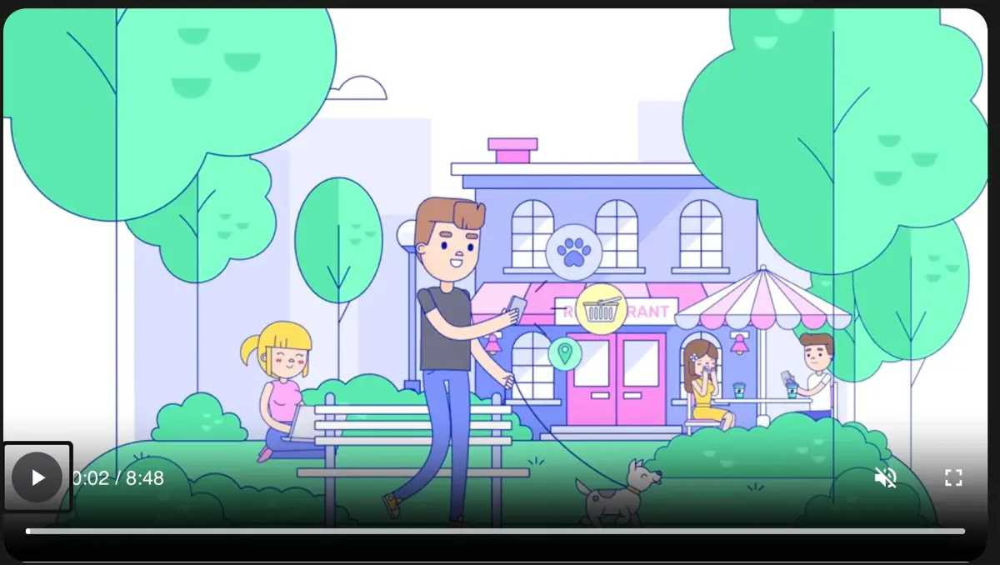
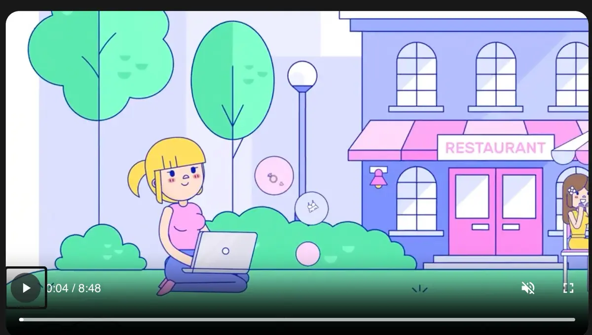
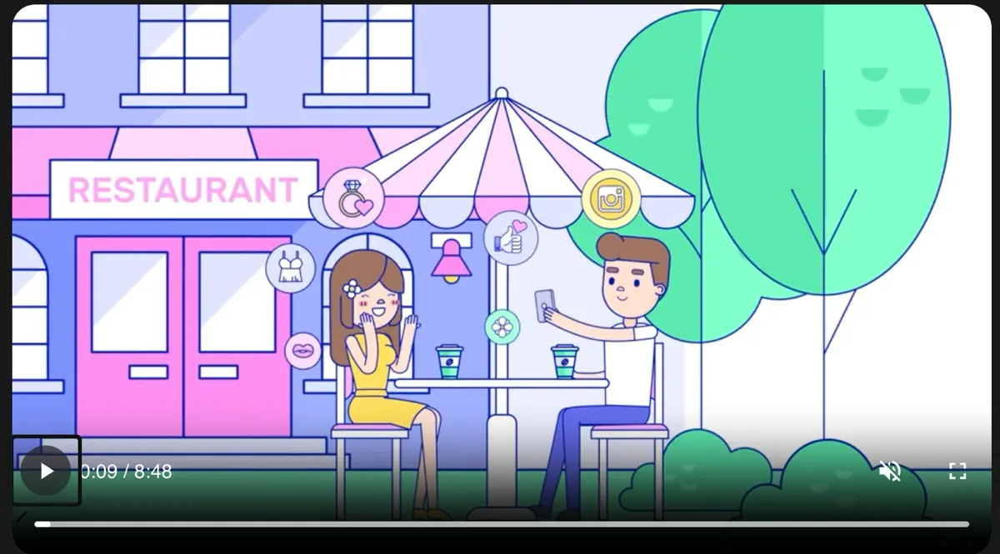
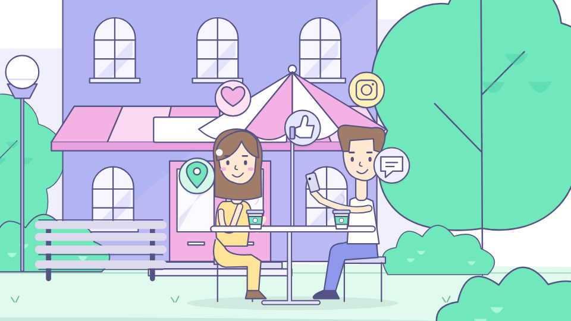

# 2.5D Vector Explainer

> **Arabic video (RTL).** Start on the right and build toward the left. Draw, write, and reveal elements right to left, and lay out the screen in that same order. Follow the [global Arabic video direction rule](../../AGENTS.md#arabic-video-direction-rtl).

Template ID: `vector-explainer`. Create it with `$make-video` and
`--template vector-explainer`. Listed in the [template catalog](../../README.md#templates).

## الفكرة المحفوظة

تمبليت موشن جرافيك ثنائي الأبعاد برسوم فيكتور وألوان باستيل وحدود بنفسجية رفيعة.
المشهد مكوّن من عناصر مستقلة، مثل الأشجار والمبنى والشخصيات وأجزاء الجسم والأيقونات.
كل عنصر له توقيت ظهور وحركة منفصلان. الكاميرا تنزل من مساحة بيضاء لتكشف المكان،
ثم تقرّب على شخصية، وبعدها تتحرك إلى شخصية أخرى. الأيقونات تنتقل بين الشخصيات
لتربط المشاهد بصريًا. حركة الأطراف والكتابة والمشي والرمش مستمرة أثناء حركة الكاميرا.

المثال المعتمد مدته ١٠ ثوانٍ، أفقي 1920×1080، بدون صوت أو كتابة.
يبدأ بحديقة وكافيه وشخص يمشي بكلب، ثم يقرب على بنت تستخدم لاب توب، ثم تنتقل
الأيقونات والكاميرا إلى شخصين جالسين في الكافيه. المكان والشخصيات قابلون للتغيير
في الفيديوهات المقبلة، مع الحفاظ على أسلوب الطبقات والحركة المترابطة.

## Approved look and motion

This is a layered 2D vector explainer with camera animation and light parallax.
The drawings are React SVG components. Each prop and character has its own transform,
and characters contain separately animated hands, limbs and faces. A shared world-space
camera pans and zooms between focal points while the distant skyline shifts more slowly.

- White sky, mint foliage, lavender buildings, pink accents, pale yellow and warm skin tones.
- Thin rounded purple outlines, flat vector fills and restrained ground shadows.
- Staggered fade-and-rise entrances for trees, architecture, shrubs, props and people.
- Smooth eased camera moves with time to read the action at each destination.
- Small continuous actions: typing hands, walking legs and dog gait, blinking, a phone hand,
  café gestures, drifting foliage, coffee steam and floating icons.
- Icons emerge near the laptop, travel on curved paths and settle around the café couple.
  They remain independent objects throughout the move.

The opening begins with white, as requested for this template. This is an intentional
exception to the house default of a fully composed first frame. Use this approved pastel
illustration style for this template even when other projects use the general UI palette.

## Saved references and example

| Park and wide scene | Laptop close-up | Café close-up |
| --- | --- | --- |
|  |  |  |

The three screenshots were supplied by the owner on 2026-11-17. They are visual references
for framing, color, independent motion and camera continuity. The starter redraws the scene
in SVG. Its artwork and character designs are an adaptation of the references.



[Watch the approved 10-second silent example](preview.mp4).
The saved MP4 is 1920×1080 at 30fps, 300 frames, with no audio stream.
The original project is [video-39-layered-city](../../../videos/video-39-layered-city/script.md).

For additional reusable characters, see [شِلّة المكتب: six React/SVG character designs](characters/README.md).
The set includes a short, round, bald employee and five other comedy characters, with static previews.

## Start a new video

Run from the repository root:

```bash
python3 tools/create_project.py --format video --template vector-explainer \
  --narration none --slug my-layered-scene --duration 10
```

The new project contains its own editable `World.tsx`, copied from
[the saved starter](World.tsx), and a composition entrypoint with its new ID.
The default duration is 10 seconds, horizontal 1920×1080 at 30fps. An explicit duration
rescales all starter camera and action cues together. Vertical output needs a deliberately
reframed camera and layout; the scaffold currently accepts `--format video` only.

Use this request in future chats:

> استخدم تمبليت 2.5D Vector Explainer لعمل فيديو عن [الموضوع] مدته [المدة].
> حافظ على الرسوم الفيكتور والطبقات المتحركة بشكل مستقل وحركة الكاميرا الناعمة،
> وخلي عنصر أو مجموعة أيقونات تربط المشاهد ببعضها. الصوت [بدون صوت أو نوع التعليق].

## Adapt the scene

1. Read the new project's `project.json` and decide the focal action for each scene.
   Keep a continuous illustrated world when the story benefits from camera travel.
2. Edit the new project's `World.tsx`. The `C` palette controls the colors.
   `Tree`, `Bush`, `Cafe`, `LaptopGirl`, `Walker`, `Couple`, `Umbrella`, `Cup` and `Icon`
   are the editable illustration components. Replace or reposition them for the new topic.
   Work in the new project's copy so the approved template and earlier videos stay intact.
3. Set entrance times in the `Reveal` calls and action cues inside each character.
   Split new artwork into meaningful movable parts, such as forearm, hand, phone and screen.
   Keep hands attached to bodies and props during gestures.
4. Author camera position with `cx`, `cy` and `zoom` in `VectorExplainerWorld`.
   The world uses a 1600×900 SVG coordinate system mapped onto the output canvas.
   Place important faces and props inside the camera crop at each hold.
5. Edit `FloatingIcons` to change icon designs, reveal order, source positions, destinations
   and travel windows. Keep their paths clear of faces and important props during both
   camera travel and the final hold.
6. Update the project's beats and script to describe its actual sequence.

The starter is an editable scene, with authored timing, rather than a JSON-driven scene
editor. Cue values use a 300-frame reference timeline. `frame * 300 / durationInFrames`
rescales this timeline to the composition's duration. For longer stories, author additional
scene actions and camera holds instead of stretching every small gesture across the whole film.

| Starter time | Action |
| --- | --- |
| 0–2.9 s | Descend from white; stagger in the park, café and people. |
| 2.9–6 s | Zoom into the laptop user; typing and separate icon reveals. |
| 6–8.3 s | Pan toward the café as icons travel along curved paths. |
| 8.3–10 s | Hold on the couple with gestures, steam and floating icons. |

## Narration and verification

Silent output is the default. Recorded or AI narration can use the project's normal
narration workflow and generated composition wrapper. For AI narration, use
`tools/prepare_narration.py` once for the whole performance. Re-time camera moves and
reveals to aligned word times when narration exists. Captions are optional and default to none.

Animation uses Remotion frame time, deterministic SVG transforms and clamped interpolation.
Keep motion frame-driven when extending it. React and SVG cover this template's illustrated
camera moves; add a 3D engine only when the new story needs actual 3D geometry or perspective.

After editing, generate the registry and typecheck, then render frames from every reveal,
camera move and hold before the full render. Use the new project's composition ID:

```bash
cd remotion
npm run gen
npx tsc --noEmit
node scripts/frames.mjs <CompositionId> 0,36,78,150,208,270 --scale=0.5
node scripts/render-all.mjs <CompositionId> --scale=1
```

These frame numbers refer to the 10-second starter. Scale or replace them for other durations.
Inspect the moving limbs, hand-to-prop contact, camera crops, icon spacing and final frame.
For strict silent delivery, remove any silent audio stream added by the renderer with an
FFmpeg video-only remux and verify the final MP4 duration and stream list with `ffprobe`.
