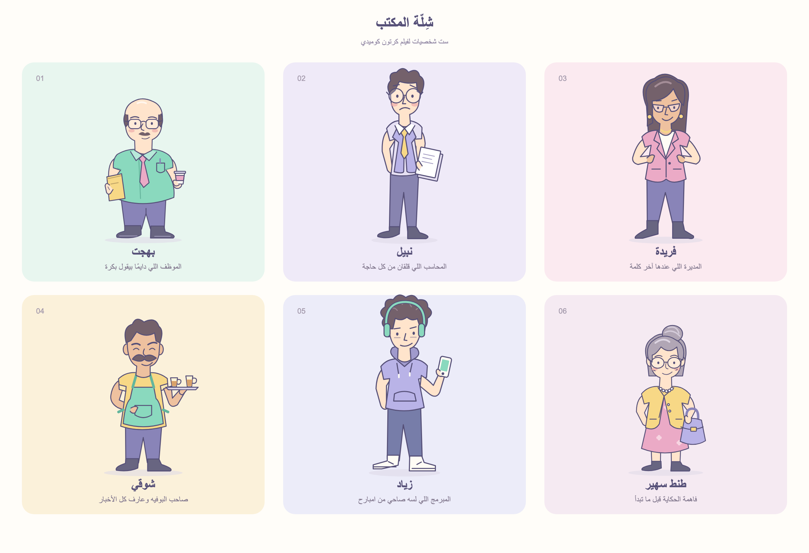
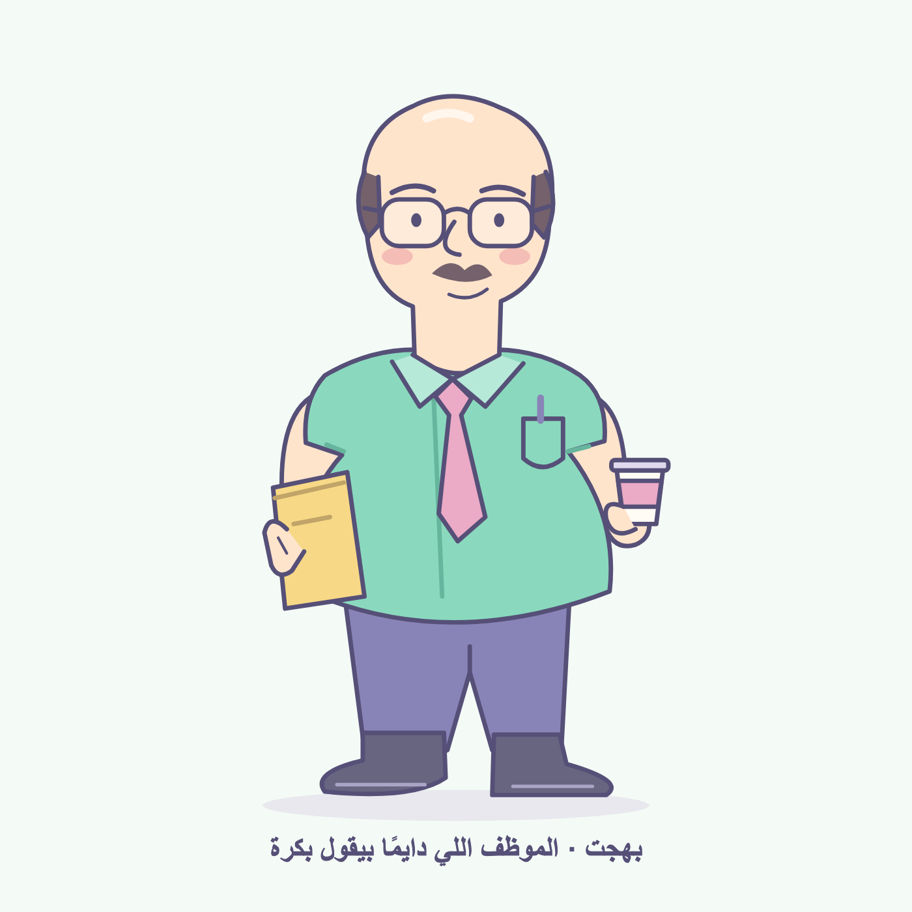

# شِلّة المكتب

Six static character designs in the 2.5D Vector Explainer style, authored as React SVG.
The previews are still images; no video was created for this character-design pass.



| Character | Design | React export |
| --- | --- | --- |
| بهجت | Short, round, bald office employee with glasses, a small moustache, file and coffee. | `BahgatEmployee` |
| نبيل | Tall, narrow, worried accountant with oversized glasses and a stack of papers. | `NabilAccountant` |
| فريدة | Confident manager with a bob haircut, angular glasses, pink blazer and hands on hips. | `FaridaManager` |
| شوقي | Friendly tea master with a large moustache, mint apron and tea tray. | `ShawkyTeaMaster` |
| زياد | Lanky, tired developer with curly hair, headphones, hoodie and phone. | `ZiadDeveloper` |
| طنط سهير | Short older woman with a bun, glasses, yellow cardigan and a large handbag. | `TanteSoheir` |

Source: [vector-comedy-cast.tsx](../../../../remotion/src/lib/vector-comedy-cast.tsx).
Each character exports an SVG group accepting `x`, `y` and `scale` inside a parent SVG.
Local feet meet y=440. `ComedyCastSheet` and `BahgatDetailSheet` export complete SVG boards.

```tsx
import {BahgatEmployee} from '../../lib/vector-comedy-cast';

const Scene = () => (
  <svg viewBox="0 0 800 600">
    <BahgatEmployee x={400} y={80} scale={1} />
  </svg>
);
```

The head and neck use a single contour. Arm roots extend under sleeves, shirts overlap
trousers, and trouser hems overlap the shoes. Internal outlines mark clothing edges.
These choices avoid exposed joins in the illustrated resting poses. When adding movement,
retain these overlaps and check the most extended poses so joints stay covered.
The current deliverable is static character art, with no skeletal or animation rig claimed.

The PNGs are rendered from these components. The matching [cast SVG](cast-sheet.svg)
and [Bahgat SVG](bahgat-detail.svg) were exported from the same React source.


